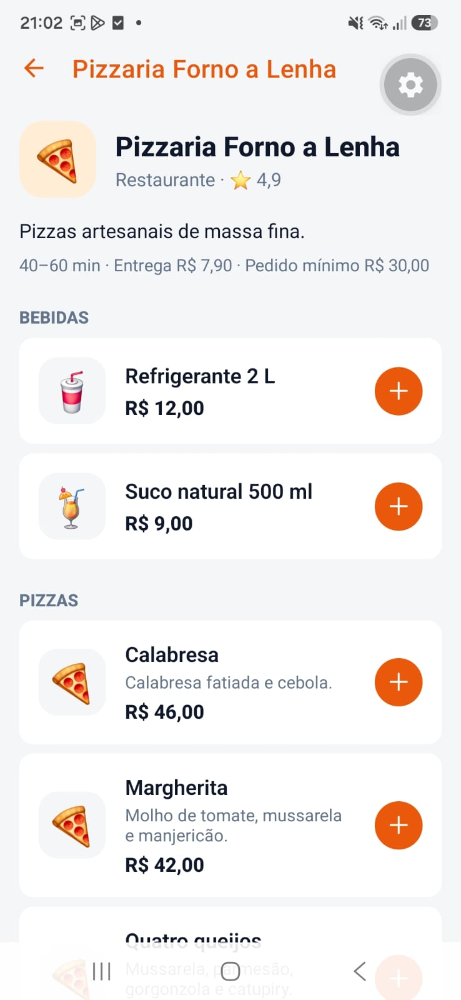
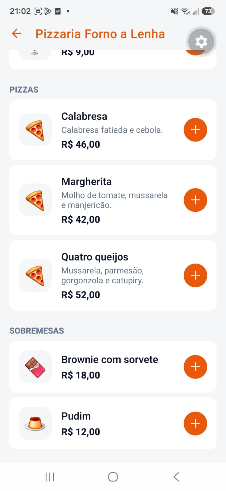
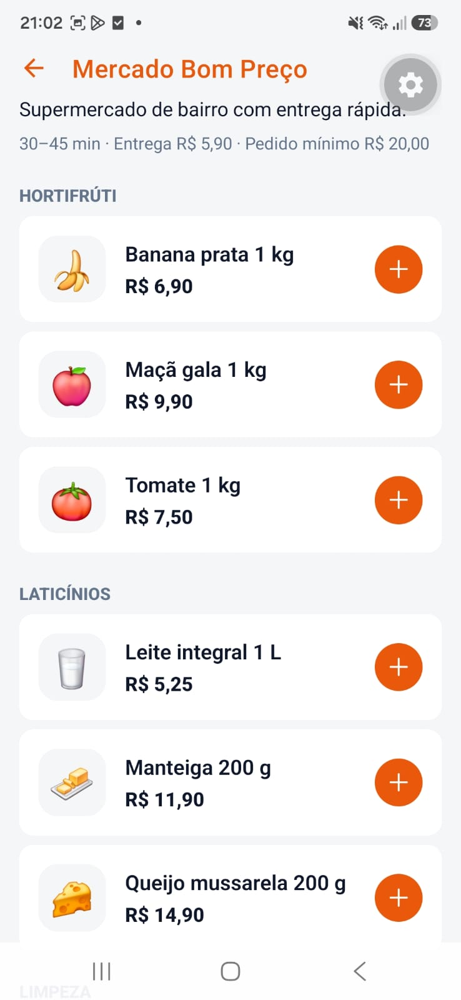
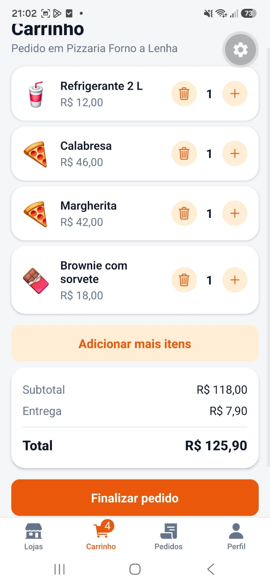
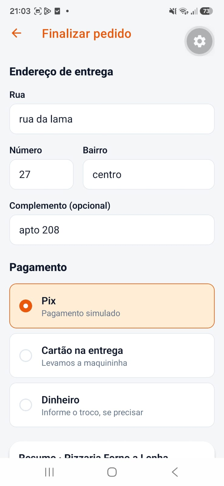
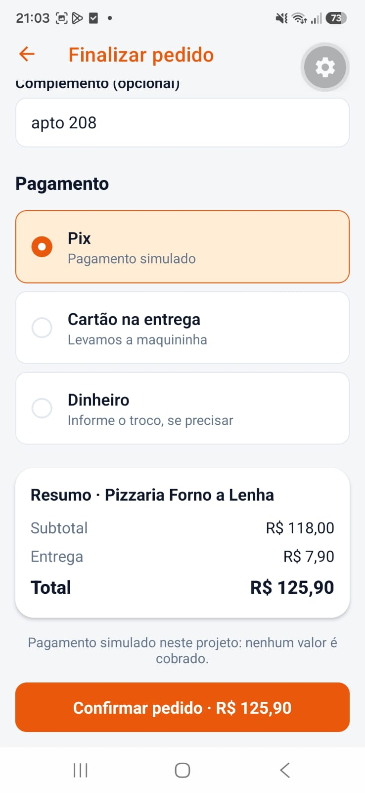
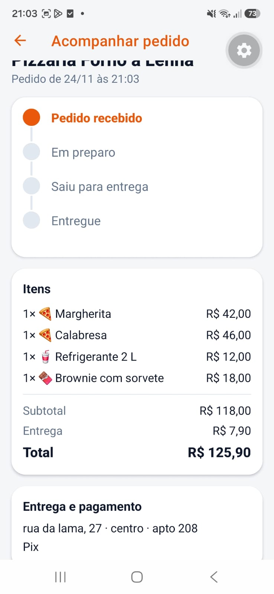
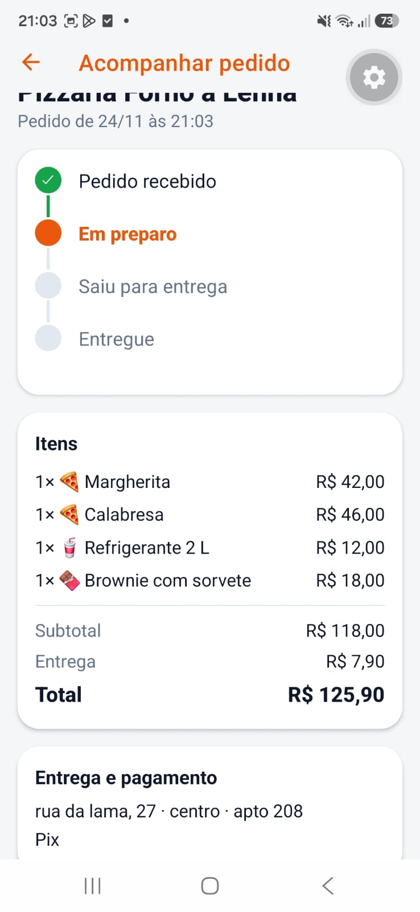
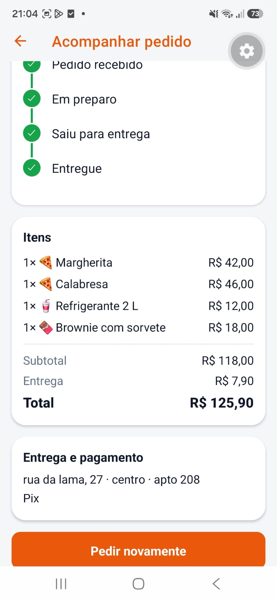
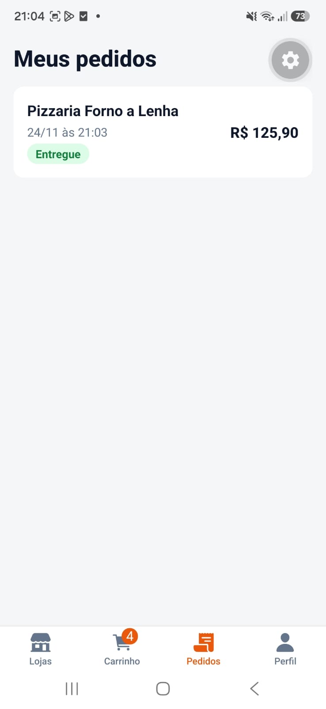

# MarketGo

Aplicativo mobile de compras com entrega: escolha uma loja, monte o carrinho, finalize o
pedido e acompanhe cada etapa até a entrega. Os pagamentos são simulados.

## Capturas de tela

Testado no Android, pelo Expo Go (SDK 58).

| Login | Cadastro | Lojas | Loja fechada |
| :---: | :---: | :---: | :---: |
|  |  |  |  |

| Perfil | Cardápio | Cardápio (sobremesas) | Mercado |
| :---: | :---: | :---: | :---: |
|  |  |  |  |

| Loja fechada (Sushi) | Carrinho | Checkout: endereço | Checkout: pagamento |
| :---: | :---: | :---: | :---: |
|  |  |  |  |

| Pedido recebido | Em preparo | Entregue | Histórico |
| :---: | :---: | :---: | :---: |
|  |  |  |  |

## Funcionalidades

- Cadastro, login e sessão persistente (Supabase Auth)
- Catálogo de lojas com busca, filtro por categoria e aviso de loja fechada
- Cardápio por seção, detalhe do produto e carrinho **salvo no aparelho**
- Regra de negócio: um carrinho por loja, com confirmação para trocar de loja
- Checkout com endereço, forma de pagamento e troco, validados com Zod
- Pedido criado no banco por uma função que **calcula o total com os preços do servidor**
- Acompanhamento com linha do tempo (atualiza sozinho), cancelamento e "Pedir novamente"
- Histórico de pedidos e dados isolados por usuário (Row Level Security)

## Tecnologias

React Native · Expo · Expo Router · TypeScript · Supabase (Auth, Postgres, RLS, funções SQL) ·
TanStack Query · React Hook Form · Zod · Jest · PGlite (testes do banco)

## Como executar

Requisitos: Node 22.13+ ou 24.3+ e o Expo Go do **SDK 58** no celular.

1. Instale as dependências: `npm install` e `npx expo install --fix`
   (no Windows: `1-instalar.bat`).
2. Crie um projeto no [Supabase](https://supabase.com) e execute, nesta ordem,
   `supabase/schema.sql` e `supabase/seed.sql` no SQL Editor (ou `supabase/setup-completo.sql`,
   que junta os dois; no Windows: `0-configurar-supabase.bat`).
3. Copie `.env.example` para `.env` e preencha a URL e a chave pública do projeto.
4. Inicie o app: `npx expo start -c` e abra no Expo Go (no Windows: `2-iniciar.bat`).

## Segurança em uma linha

O app **não escreve** em `orders` nem em `order_items`: não há política de insert, update ou
delete. Toda escrita passa por funções (`create_order`, `advance_order`, `cancel_order`) que
validam os dados, calculam preços e controlam o status.

## Testes

| Comando            | O que testa                                            |
| ------------------ | ------------------------------------------------------ |
| `npm test`         | Tudo: app (Jest) e banco (PGlite), 62 testes           |
| `npm run test:app` | Carrinho, catálogo, pedidos, checkout, dinheiro e erros (46) |
| `npm run test:db`  | RLS, permissões, cálculo do pedido e status (16)       |

O teste do banco usa o PGlite (Postgres real dentro do Node), com o mesmo `schema.sql` e
`seed.sql` do Supabase, sem Docker.

## Arquitetura

```
app/         rotas (Expo Router)
src/
  components/  interface reutilizável
  context/     sessão e carrinho
  hooks/       consultas e mutações (TanStack Query)
  services/    acesso ao Supabase
  schemas/     validação (Zod)
  utils/       regras puras, cobertas por testes
supabase/
  schema.sql, seed.sql   banco, RLS e funções
  tests/                 testes do banco
```

## Correções em relação ao guia

O projeto segue o guia da disciplina, com 18 correções marcadas no código com
`// CORREÇÃO Cxx` (ou `-- CORREÇÃO Cxx` no SQL). Para listar: `grep -rn "CORREÇÃO" app src supabase`.
O relatório completo, com o prompt usado, o diagnóstico e o teste no celular, está em
[`docs/RELATORIO-CORRECOES.md`](docs/RELATORIO-CORRECOES.md).

## Autor

**Natan Forte Sauer** — Programação para Dispositivos Móveis, IESB (Prof. Me. Bruno Assunção Dias)

- GitHub: https://github.com/natansauer
